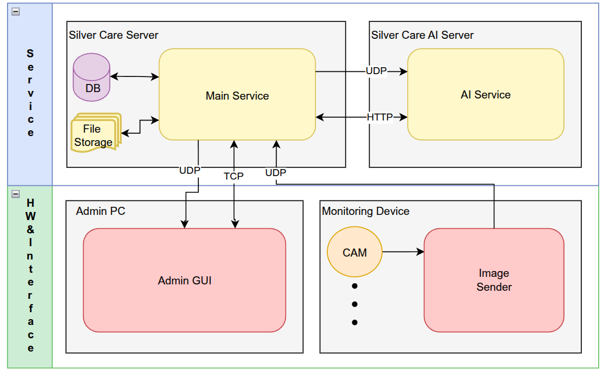
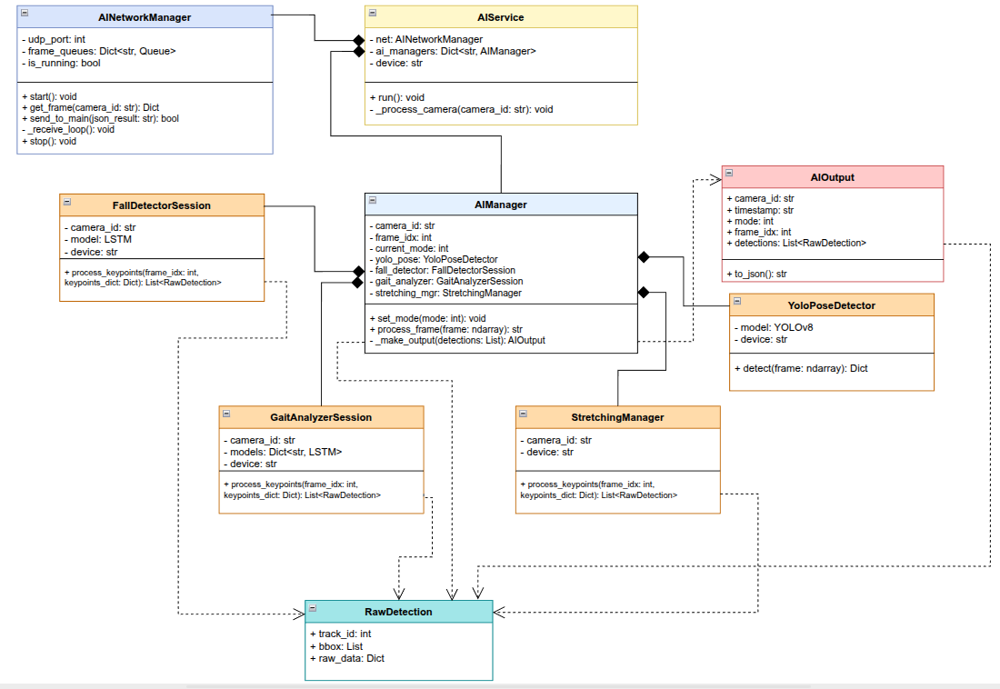
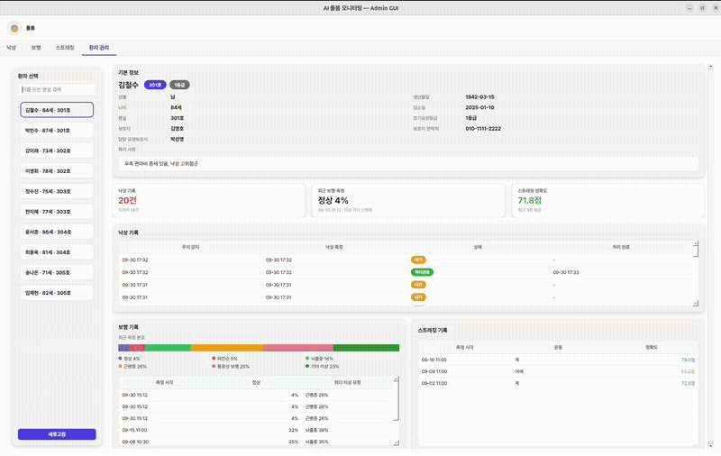
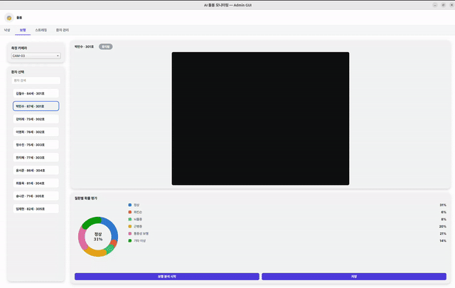
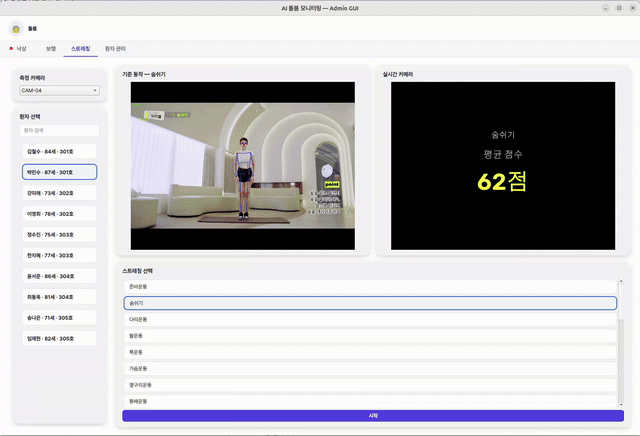
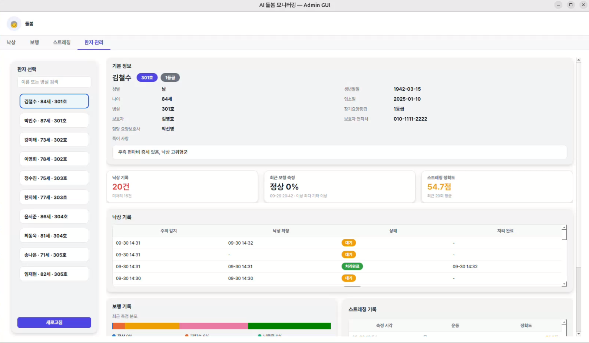

# deeplearning-repo-1
딥러닝 프로젝트 1조 저장소. Dolbom

# 돌봄 (SilverCare)

AI Deep Learning 기술을 이용한 요양원 관리 시스템


[[발표자료](https://docs.google.com/presentation/d/178kyw-LluLt_m8xJG-UwvEeJahqwHwas/edit?slide=id.p1#slide=id.p1)]

# 📚 목차

- [1. 프로젝트 개요](#1-프로젝트-개요)
- [2. 기술 스택](#3-기술-스택)
- [3. 시스템 설계](#4-시스템-설계)
- [4. 주요 기능](#5-주요-기능)
- [5. 통신 프로토콜](#6-통신-프로토콜)
- [6. 기술적 문제 및 해결](#7-기술적-문제-및-해결)
- [7. 팀 구성](#10-팀-구성)

---

# 1. 프로젝트 개요

> ⏰ 프로젝트 기간: 2026.09.18 ~ 2026.10.01 (Physical AI Engineer 부트캠프 딥러닝 프로젝트)

`돌봄`은 요양원에 설치된 카메라 영상을 YOLOv8 Pose로 분석해 **낙상 감지 · 보행 이상 진단 · 스트레칭 피드백** 세 가지 기능을 제공하고, 관리자가 한 화면에서 환자 상태와 기록을 관리하는 **요양원 모니터링 시스템**입니다.

| 기능 | 카메라 | 방식 |
|---|---|---|
| 실시간 낙상 감지 | CAM-01 · 02 (병실) | YOLO Pose + LSTM 낙상 확률 → 1.5초 누적 판정 |
| 보행 패턴 이상 진단 | CAM-03 | YOLO Pose + 질환별 LSTM 6개 (OvR) |
| 스트레칭 · 재활 피드백 | CAM-04 | YOLO Pose + 기준 자세 비교 (규칙 기반 점수) |


# 2. 기술 스택

| 구분 | 사용 기술 |
|---|---|
| Language | Python |
| AI / Vision | YOLOv8n-pose (Ultralytics), PyTorch LSTM, OpenCV, NumPy |
| GUI | PyQt6 (PyQt5 호환) |
| Network | UDP, TCP, HTTP (`http.server`, `requests`) |
| Database | MySQL (PyMySQL) |
| Collaboration | GitHub, Confluence |

---

# 3. 시스템 설계

## 폴더 구조

```
deeplearning-repo-1/
├── hardware/
│   └── image_sender.py         # 카메라 영상 → Main Service (UDP)
├── main_service/
│   ├── main_server.py          # 실행 진입점, 모드 관리, GUI 명령 처리
│   ├── main_networkmanager.py  # 카메라 수신 / AI 송수신 / GUI 송수신
│   ├── fall_analyzer.py        # 낙상 확률 시계열 → 상태 판정
│   ├── stretching_analyzer.py  # 기준 자세 비교 → 점수 · 단계
│   └── db_manager.py           # MySQL 조회 · 저장
├── ai_server/
│   ├── ai_service.py           # 실행 진입점, 카메라별 처리 스레드
│   ├── ai_networkmanager.py    # 영상 수신 (UDP) / 결과 전송 (HTTP)
│   ├── ai_manager.py           # 카메라별 모드 전환 · 모듈 호출
│   ├── yolo_pose.py            # YOLOv8 Pose 관절 추출
│   ├── fall_detector.py        # 낙상 LSTM
│   ├── gait_analyzer.py        # 보행 질환별 LSTM 6개
│   ├── stretching_manager.py   # 스트레칭 특징값 추출
│   ├── data_models.py          # RawDetection, AIOutput
│   └── models/                 # 학습된 모델 가중치
├── admin_gui/
│   ├── app.py                  # 실행 진입점, 탭 구성
│   ├── network.py              # 영상 (UDP) / 결과 · 명령 (TCP)
│   ├── fall_tab.py · gait_tab.py · stretch_tab.py · patient_tab.py
│   └── drawing.py              # 스켈레톤 · 색상 오버레이
├── config/
│   └── settings.py             # 포트, 카메라 역할 · FPS, 모델 경로, DB 설정
└── database/
    └── db.sql                  # 스키마 (patients, fall_logs, gait_logs, stretch_logs)
```

## 시스템 아키텍처



- **Main Service**가 모든 흐름의 중심입니다. 카메라 영상을 받아 AI Server와 GUI로 보내고, AI 결과를 모드별로 분석해 GUI에 전달합니다.
- **AI Server**는 GPU로 모델 추론만 하고, 시간에 따른 판단(낙상 확정, 기준 자세 비교, DB 기록)은 Main Service가 합니다.
- DB와 기준 자세 파일은 Main Service만 접근하고, GUI는 Main Service에 요청만 보냅니다.

## AI Server 클래스 다이어그램



- 카메라마다 `AIManager`가 하나씩 있고, 현재 모드에 맞는 모듈 하나만 실행합니다.
- 세 모듈(`FallDetectorSession`, `GaitAnalyzerSession`, `StretchingManager`)은 모두 `process_keypoints() → List[RawDetection]` 형태가 같아서, 새 기능도 같은 형태로 붙일 수 있습니다.
- 무거운 LSTM 모델은 한 번만 로드해 카메라끼리 공유하고, 추적 ID · 시계열 버퍼 같은 상태만 카메라별로 가집니다.

## 데이터베이스

| 테이블 | 내용 |
|---|---|
| `patients` | 환자 기본 정보 (병실, 등급, 보호자, 특이 사항) |
| `fall_logs` | 주의 감지 · 낙상 확정 · 처리 완료 시각, 처리 보호사 |
| `gait_logs` | 보행 측정 시 질환별 확률 분포 |
| `stretch_logs` | 스트레칭 동작별 평균 점수 |

---

# 4. 주요 기능

## 실시간 낙상 감지



- AI가 프레임마다 LSTM 낙상 확률을 계산하고, Main이 최근 **1.5초 중 70% 이상**이 낙상 프레임이면 낙상으로 확정합니다.
- 주의(주황) → 낙상(빨강)으로 카드 테두리와 알림이 바뀌고, 보호사가 이름을 입력해 처리 완료하면 DB에 기록됩니다.
- 다른 화면을 표기하고 있어도 낙상이 감지되면 알림이 뜨고, 알림을 클릭하면 낙상 탭으로 이동합니다. 

## 보행 패턴 이상 진단



- 30프레임(1초) 관절 시퀀스를 질환별 이진 분류 LSTM 6개(OvR)에 동시에 넣어 확률을 구합니다.
- 질환별 누적 확률을 도넛 차트로 보여주고, 저장하면 환자 기록에 남습니다.

## 스트레칭 · 재활 피드백



- 국민체조 영상을 23개 동작 구간으로 나누고, YOLO Pose로 기준 스켈레톤 JSON을 만들었습니다.
- 점수 = **팔다리 기울기 60% + 벌림 거리 40%**
  - 기울기: 어깨→손목, 엉덩이→발목 4개 선의 방향 차이 (위치 · 크기와 무관)
  - 벌림: 양 손목 · 양 발목 사이 거리 ÷ 몸통 길이 (크기와 무관)
- 70점 이상 GOOD(초록) / 50~70점 ADJUST(노랑) / 50점 미만 CHECK(빨강)로 팔다리마다 색을 표시하고, 동작이 끝나면 평균 점수를 자동 저장합니다.

## 환자 관리



- 환자 기본 정보와 낙상 · 보행 · 스트레칭 기록을 한 화면에서 조회합니다.

---

# 5. 통신 프로토콜

| 구간 | 프로토콜 | 포트 | 내용 |
|---|---|---|---|
| Image Sender → Main | UDP | 9000 ~ 9003 | JPEG (카메라마다 포트 1개) |
| Main → AI Server | UDP | 9100 | JSON `{camera_id, mode, frame_idx, frame(base64)}` |
| AI Server → Main | HTTP POST | 5000 `/ai_result` | AIOutput JSON (모드별 분석 결과 + frame_idx) |
| Main → GUI | UDP | 9998 | `[헤더 길이][JSON 헤더][JPEG]` |
| Main ↔ GUI | TCP | 9999 | 분석 결과 ↓ / 명령 · DB 요청 ↑ (한 줄에 JSON 하나) |
| Main ↔ DB | MySQL | 3306 | 환자 · 기록 조회 및 저장 |

- **영상은 UDP**: 늦게 온 프레임은 쓸모가 없어서, 한 장 빠져도 다음 장으로 넘어갑니다.
- **결과 · 명령은 HTTP · TCP**: 빠지면 안 되는 데이터라 도착이 보장되는 방식을 씁니다.
- **frame_idx**: Main이 프레임마다 번호를 붙여 AI와 GUI로 동시에 보내고, GUI는 같은 번호의 영상 위에 결과를 그립니다. AI 처리가 늦어도 영상과 스켈레톤이 어긋나지 않습니다.

GUI → Main 명령 예시

```json
{"cmd": "start_stretching", "req_id": 3, "camera_id": "CAM-04", "patient_id": 1, ...}
{"type": "response", "cmd": "start_stretching", "req_id": 3, "ok": true, "data": {...}}
```

---

# 6. 기술적 문제 및 해결

## 1) 해상도 차이로 스트레칭 점수가 60점에서 막힘

**문제**: 기준 영상(1920×1080)과 웹캠(640×480)의 해상도가 약 3배 달라, 손목 사이 거리를 픽셀로 비교하면 차이가 항상 최대로 나왔습니다. 벌림 점수가 0점이 되어 같은 자세를 해도 총점이 60점을 넘지 못했습니다.

**해결**: 벌림 거리를 **몸통 길이(어깨 중심 ↔ 엉덩이 중심)로 나눈 비율**로 비교했습니다. 크게 찍히든 작게 찍히든 비율은 같아서 해상도 영향이 사라졌습니다. 몸통은 옆으로 도는 동작에서도 길이가 거의 변하지 않아 기준으로 삼았습니다.

## 2) FPS 차이로 인한 싱크 지연

**문제**: 처음에는 frame_idx 번호로 기준 자세를 찾았습니다. 카메라는 15fps, 기준 영상은 약 24fps라 같은 번호여도 실제 시점이 달라 **10초마다 약 3.7초씩** 어긋났고, 영상이 끝나도 세션이 약 1.6배 더 이어졌습니다.

**해결**: 스트레칭 시작 시각부터 **경과 시간 × 기준 영상 FPS**로 같은 시점의 기준 자세를 찾도록 바꿨습니다. 프레임이 Main에 도착하는 순간 frame_idx ↔ 기준 번호를 짝지어 두기 때문에 AI 처리가 늦어져도 비교 대상은 바뀌지 않습니다. frame_idx는 결과와 캠 프레임을 짝짓는 데만 씁니다. 카메라 FPS를 맞추는 방법도 있지만, UDP 유실이나 프레임 드랍이 한 번만 생겨도 번호가 다시 밀리기 때문에 시간 기준을 택했습니다.

## 3) 처리 지연 누적

**문제**: AI 처리보다 프레임이 빨리 들어오면 대기열에 쌓여 화면이 점점 늦어졌습니다.

**해결**: AI 서버의 카메라별 대기열 크기를 1로 두어, 처리 못 한 이전 프레임은 버리고 항상 최신 프레임만 처리합니다. 프레임이 빠질 뿐 지연은 쌓이지 않습니다.

## 4) 보행 단일 모델의 판별력 한계

**문제**: 단일 모델로 6개 질환을 동시에 학습하자, 정상 데이터가 많고 파킨슨 등은 적어 정상군으로 편향되고 미세한 동작 차이를 구별하지 못했습니다.

**해결**: 질환별 이진 분류 모델 6개를 두는 **OvR(One-vs-Rest) 앙상블**로 바꿔, 각 모델이 한 질환의 징후에만 집중하게 했습니다. 복합 증상도 각 모델이 독립적으로 평가해 동시에 잡아낼 수 있습니다.

---


# 7. 팀 구성

| 이름 | 담당 |
|---|---|
| 이준성 | DB, PM|
| 문상민 | Main, AI Service, 스트레칭 피드백 |
| 이준엽 | 낙상 감지 모델, GUI |
| 송주한 | 보행 감지 모델|
| 김선우 | 스트레칭 피드백, GUI|
